# Subtracting Figures

A dedicated worksheet for the **Figure Subtraction** reasoning puzzle type (Figure (1) minus Figure (2) = Figure (3)) — identified as a gap against the school's own syllabus. Each figure is built from simple parts (outlines, diagonals, flaps, a circle...); subtracting Figure (2) means removing exactly those parts from Figure (1), leaving the rest as Figure (3). 15 questions, 4-option MCQ, untimed.

---

**Q1.**
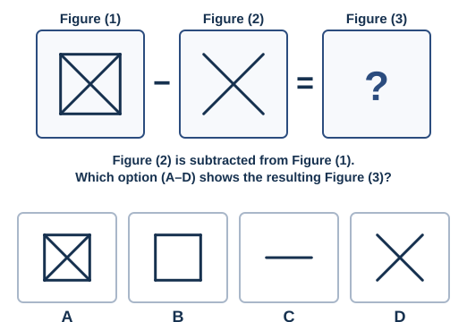

**Q2.**
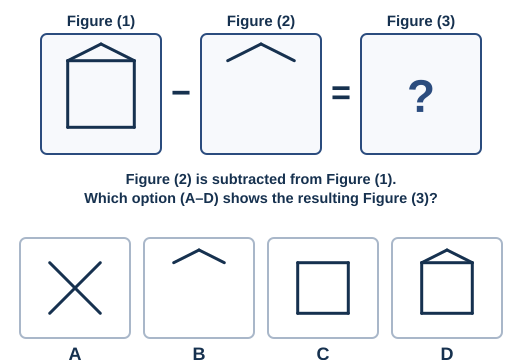

**Q3.**
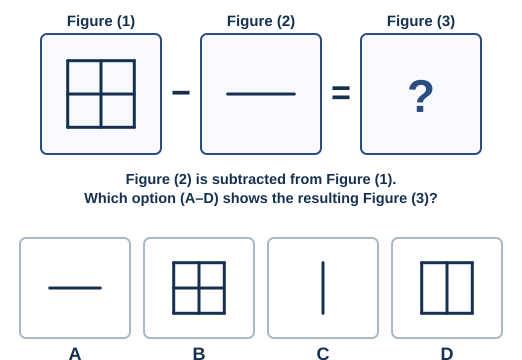

**Q4.**
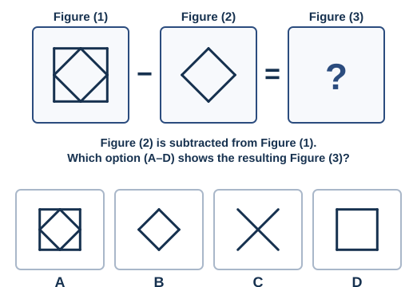

**Q5.**
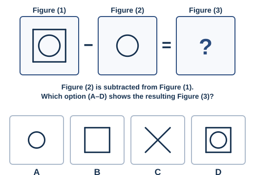

**Q6.**
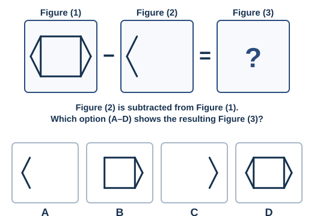

**Q7.**
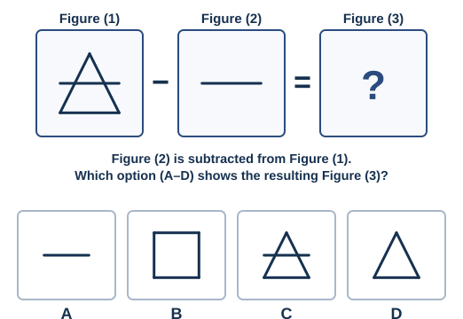

**Q8.**
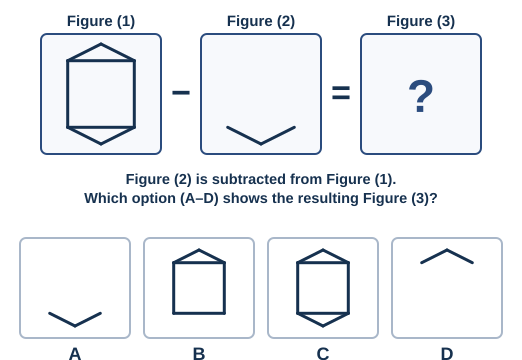

**Q9.**
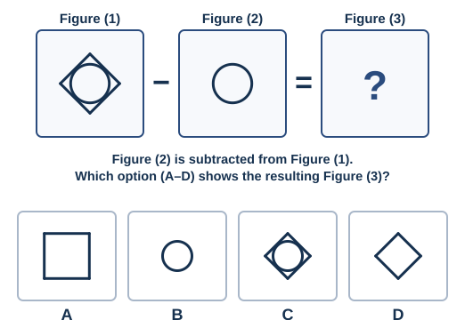

**Q10.**
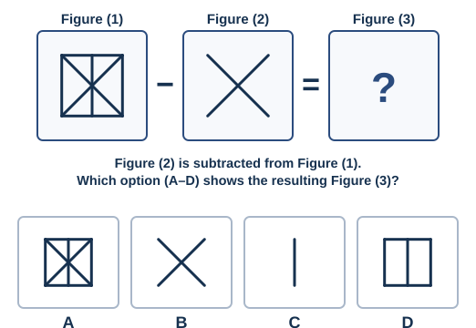

**Q11.**
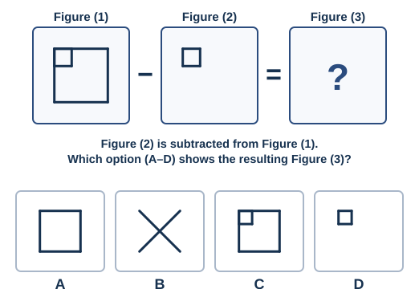

**Q12.**
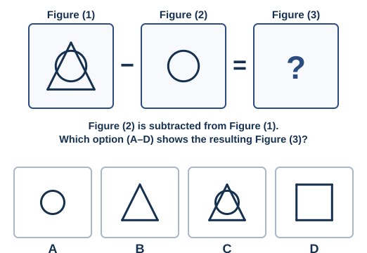

**Q13.**
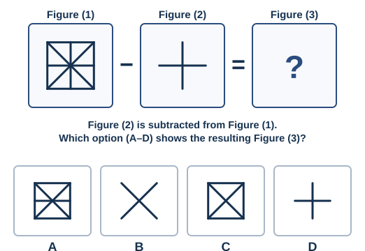

**Q14.**
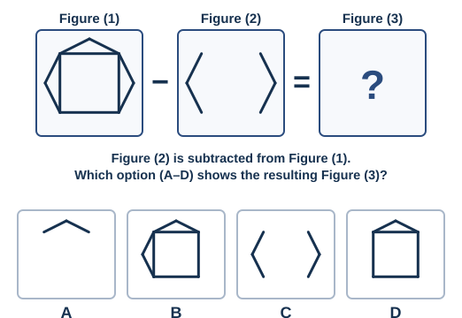

**Q15.**
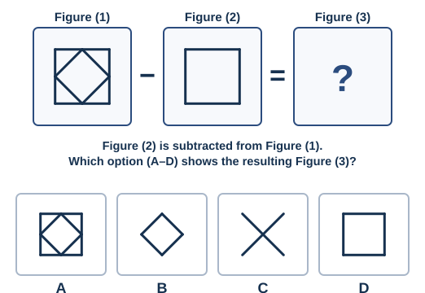

---

*Answer key: `answer-key.md`*

