# Subtracting Figures — Achievers / HOTS

A harder follow-on to `19-subtracting-figures/`: figures built from 3-4 parts with **two parts removed at once**, plus a few reversed puzzles (you're given what was subtracted and what was left over, and have to work out the original figure). 15 questions, 4-option MCQ, untimed.

---

**Q1.**
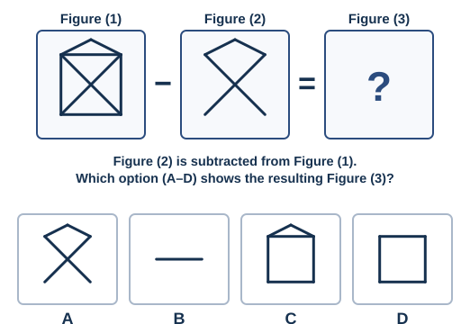

**Q2.**
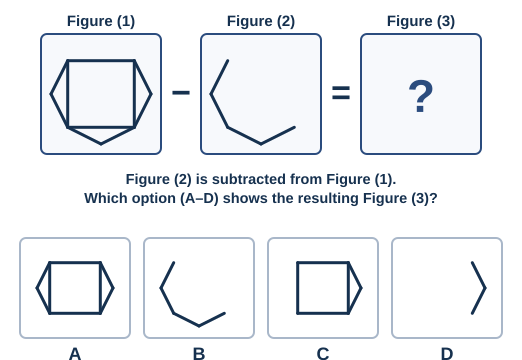

**Q3.**
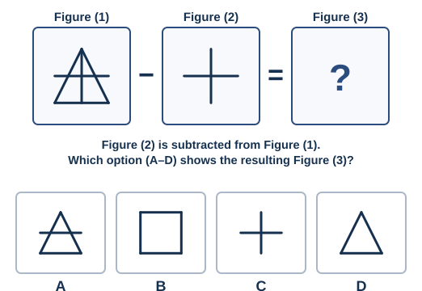

**Q4.**
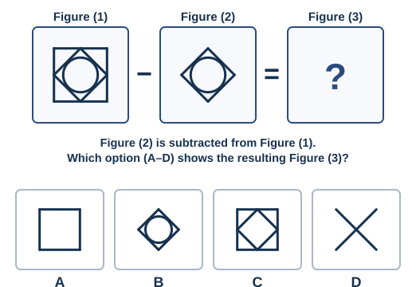

**Q5.**
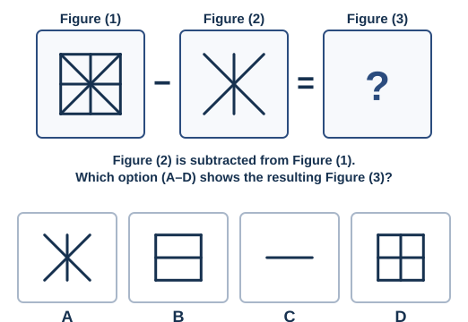

**Q6.**
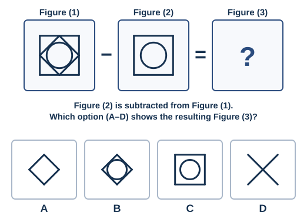

**Q7.**
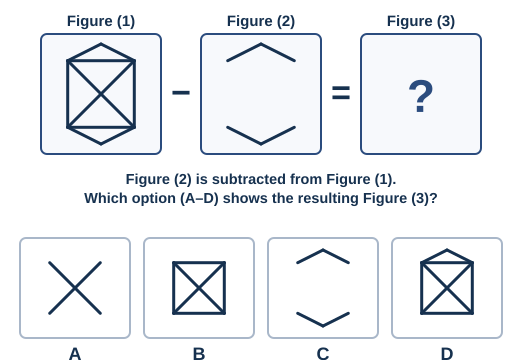

**Q8.**
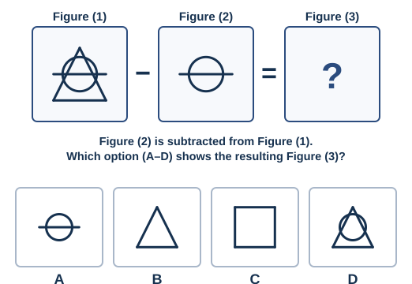

**Q9.**
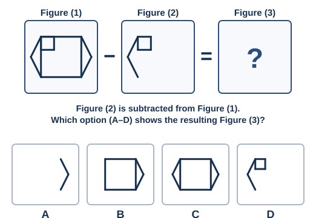

**Q10.**
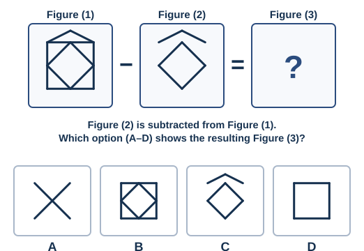

**Q11.**
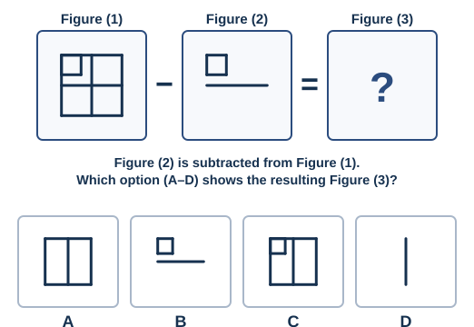

**Q12.**
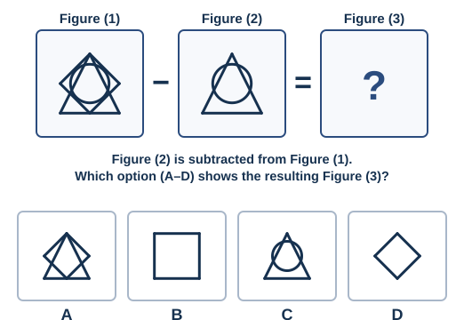

**Q13.**
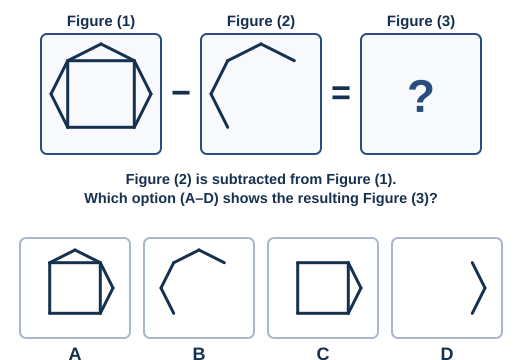

**Q14.**
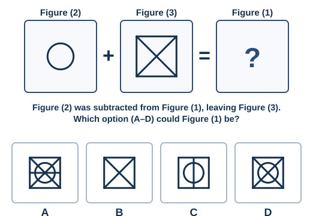

**Q15.**
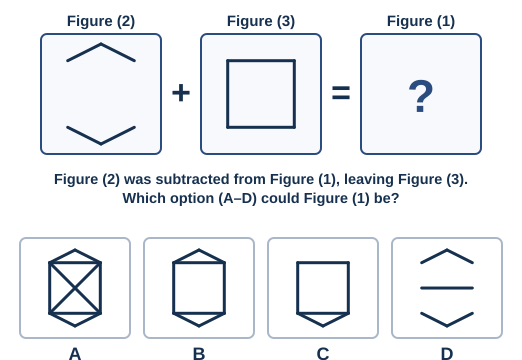

---

*Answer key: `answer-key.md`*

