# Incomplete Pattern

A dedicated worksheet for the **Incomplete Pattern** reasoning puzzle type — identified as a gap against the school's own syllabus. Each puzzle shows a 3×3 grid of figures that follow the same rule along every row; work out the rule from the two complete rows, then find the figure that completes the pattern. 15 questions, 4-option MCQ, untimed.

---

**Q1.**
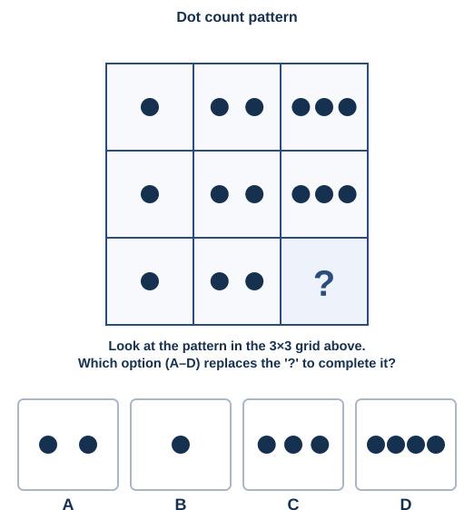

**Q2.**
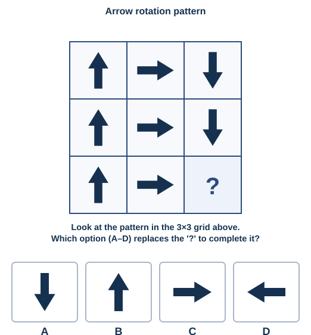

**Q3.**
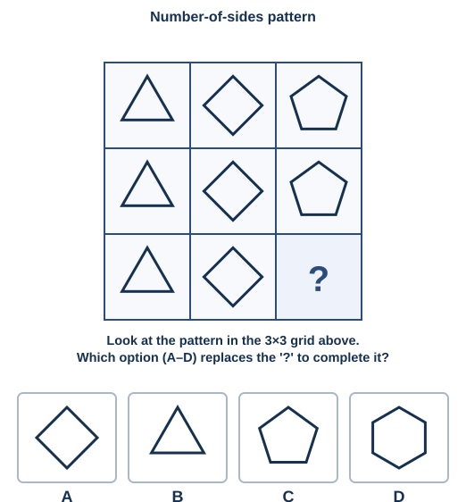

**Q4.**
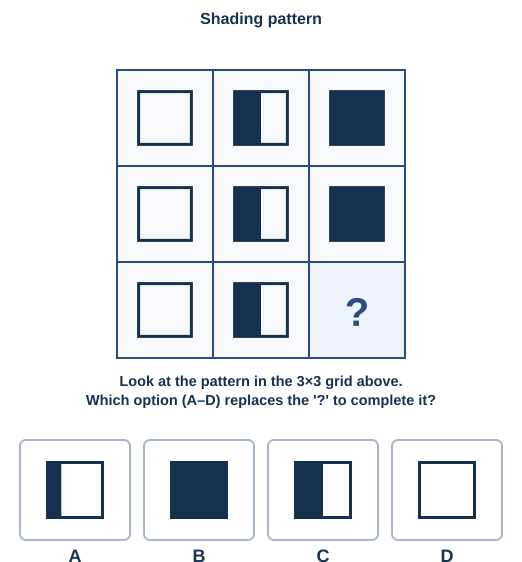

**Q5.**
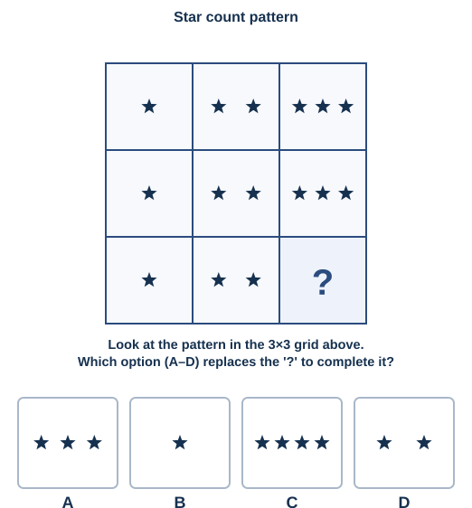

**Q6.**
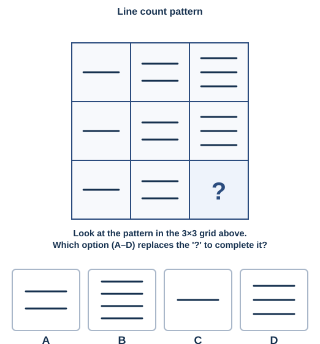

**Q7.**
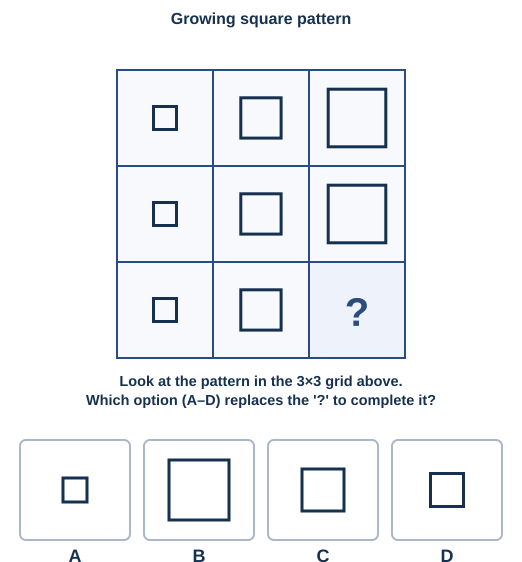

**Q8.**
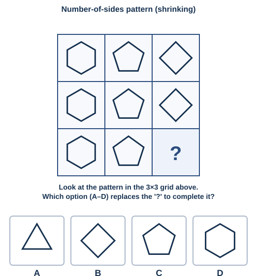

**Q9.**
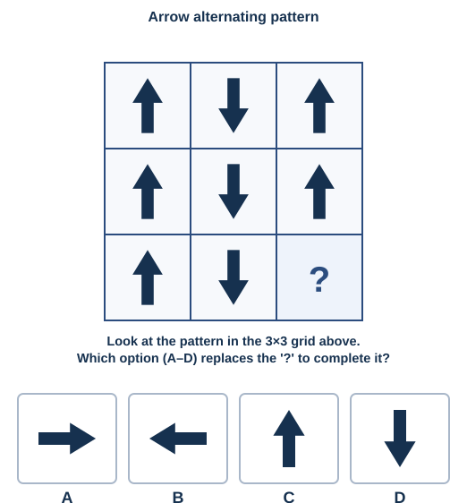

**Q10.**
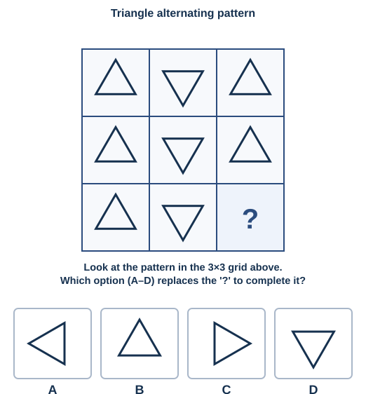

**Q11.**
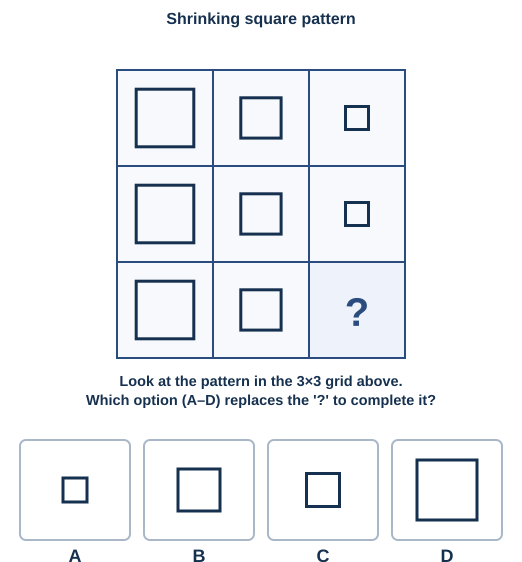

**Q12.**
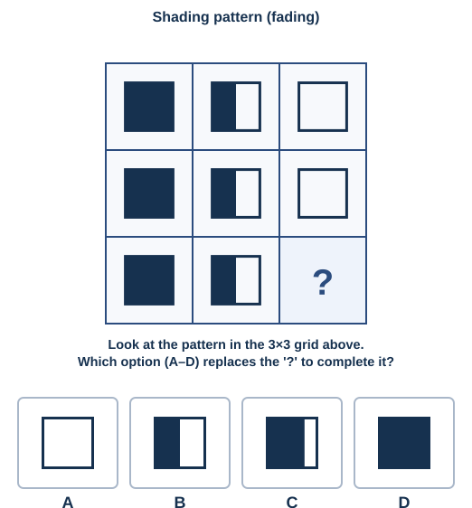

**Q13.**
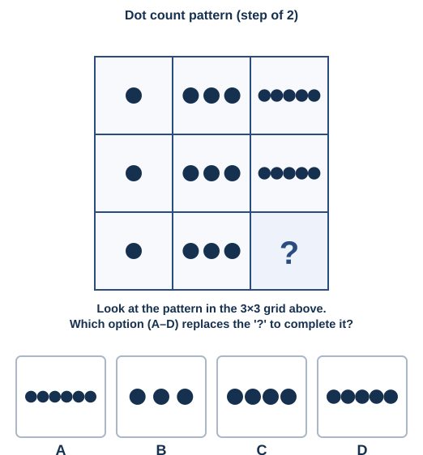

**Q14.**
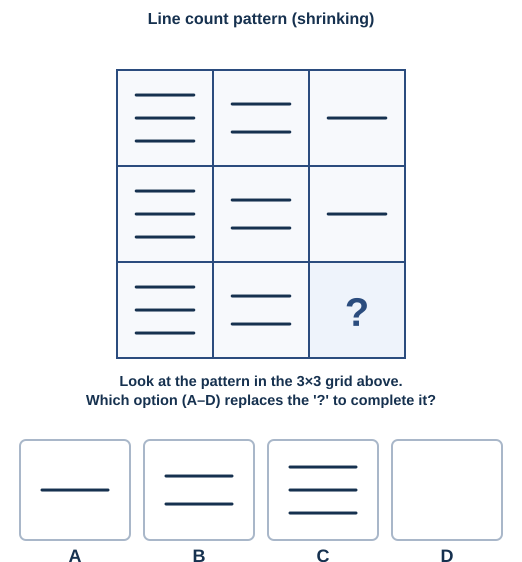

**Q15.**
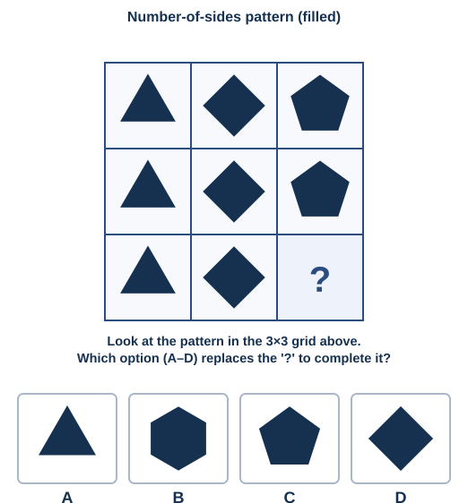

---

*Answer key: `answer-key.md`*

