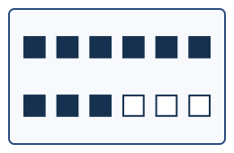
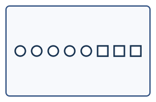
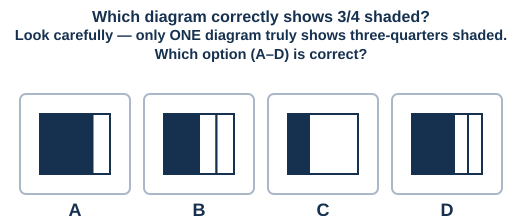

# Fraction Interpretation

A dedicated worksheet going deeper into **fraction interpretation** than Week 4 (`04-fractions-decimals/`) — identified as a gap against the school's own syllabus. Covers shaded-area fractions, fraction of a *group* of discrete objects (not just a shape), fraction of a quantity in word problems, and mixed-number ↔ improper-fraction conversion. 15 questions, 4-option MCQ, untimed.

---

**Q1.**

What fraction of the rectangle below is shaded?

A) 2/6  B) 6/2  C) 4/6  D) 3/6

**Q2.**

What fraction of the circle below is shaded?

A) 3/4  B) 4/3  C) 1/4  D) 2/4

**Q3.**

In the group of shapes below, what fraction are shaded (solid)?

A) 4/10  B) 10/4  C) 6/10  D) 3/10

**Q4.**

What fraction of the grid below is shaded?

A) 5/8  B) 8/5  C) 3/8  D) 4/8

**Q5.**

What fraction of the circle below is shaded?

A) 1/6  B) 6/1  C) 5/6  D) 2/6

**Q6.**

In the group of shapes below, what fraction are shaded, written in its SIMPLEST FORM?

A) 9/12  B) 3/4  C) 4/3  D) 1/4

**Q7.** There are 20 mangoes in a basket. 3/5 of them are ripe. How many mangoes are ripe?
A) 12  B) 8  C) 15  D) 3

**Q8.** A class has 30 students. 2/3 of them are girls. How many boys are there?
A) 10  B) 20  C) 15  D) 18

**Q9.** Convert 2 3/4 to an improper fraction.
A) 11/4  B) 9/4  C) 5/4  D) 10/4

**Q10.** Convert 17/5 to a mixed number.
A) 3 2/5  B) 2 2/5  C) 3 1/5  D) 4 2/5

**Q11.**

What fraction of the grid below is shaded?

A) 7/10  B) 10/7  C) 3/10  D) 6/10

**Q12.** 1/4 of 48 chocolates were eaten. How many chocolates are LEFT?
A) 36  B) 12  C) 24  D) 40

**Q13.**

In the group of shapes below, what fraction of the shapes are squares?

A) 3/8  B) 5/8  C) 8/3  D) 3/5

**Q14.** A pizza is cut into 8 equal slices. Priya eats 3 slices. What fraction of the pizza is LEFT (not eaten)?
A) 5/8  B) 3/8  C) 5/3  D) 3/5

**Q15.**

---

*Answer key: `answer-key.md`*

