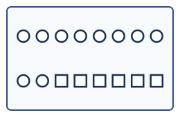
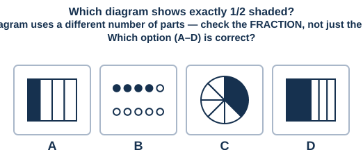
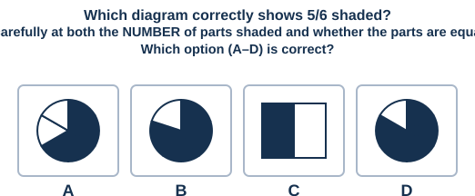

# Fraction Interpretation — Achievers / HOTS

A harder follow-on to `25-fraction-interpretation/`: multi-step word problems (fraction of a fraction, three-category splits), comparing and ordering unlike fractions, adding related-denominator fractions, mixed-number arithmetic, and visual questions that test true conceptual understanding (equivalent fractions shown with different numbers of parts, and the classic "equal parts" misconception trap). 15 questions, 4-option MCQ, untimed.

---

**Q1.** In a garden there are 45 flowers. 2/5 are roses, and the rest are lilies. How many lilies are there?
A) 27  B) 18  C) 22  D) 20

**Q2.** A fruit basket has 36 fruits. 1/3 are apples, 1/4 are bananas, and the rest are oranges. How many oranges are there?
A) 15  B) 21  C) 12  D) 9

**Q3.** Which is greater: 2/3 or 3/5?
A) 2/3  B) 3/5  C) They are equal  D) Cannot be compared

**Q4.** 1/2 + 1/4 = ?
A) 3/4  B) 2/6  C) 1/6  D) 2/4

**Q5.** 1/3 + 1/6 = ? (Give your answer in its simplest form.)
A) 1/2  B) 3/6  C) 1/9  D) 2/9

**Q6.** 3/4 of a 40-item collection are red. Of the red items, 1/3 are circles. How many red circles are there?
A) 10  B) 30  C) 13  D) 15

**Q7.**

In the group of shapes below, what fraction, in its SIMPLEST FORM, of the shapes are circles?

A) 5/8  B) 10/16  C) 3/8  D) 8/5

**Q8.** Arrange in increasing order: 1/2, 2/3, 1/4
A) 1/4, 1/2, 2/3  B) 1/2, 1/4, 2/3  C) 2/3, 1/2, 1/4  D) 1/4, 2/3, 1/2

**Q9.**

**Q10.** A ribbon 24 m long is cut so that 5/8 of it is used for decoration. How many metres are LEFT (not used)?
A) 9  B) 15  C) 19  D) 12

**Q11.** 2 1/2 + 1 1/2 = ?
A) 4  B) 3 1/2  C) 3  D) 4 1/2

**Q12.** A recipe needs 11/4 cups of flour. Express this as a mixed number.
A) 2 3/4  B) 1 3/4  C) 2 1/4  D) 3 3/4

**Q13.** There are 40 marbles. 2/5 are blue, 1/8 are red, and the rest are green. How many green marbles are there?
A) 19  B) 21  C) 16  D) 24

**Q14.** A group of shapes has 8 shapes, 5 of which are circles (so 5/8 of the group are circles). If 2 more circles are added to the group (now 10 shapes in total), what fraction of the group is now circles, in simplest form?
A) 7/10  B) 5/8  C) 7/8  D) 9/10

**Q15.**

---

*Answer key: `answer-key.md`*

